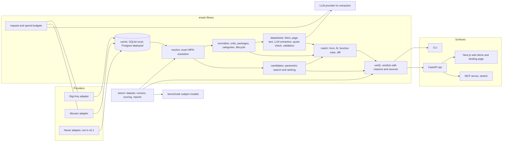

# Ersatz architecture

This document describes the system design for v0.1. Domain rules live in docs/DOMAIN.md, benchmark rules in docs/BENCHMARK_DESIGN.md, and every choice that changed from the first proposal has an entry in docs/DECISIONS.md.

## 1. System diagram



The library is the product. CLI, API, web and MCP are thin surfaces over it. Language model extraction runs offline from the CLI or a batch job and stores its results; no API request waits on a language model call.

## 2. Modules and public interfaces

Package layout:

```
ersatz/
  model/        pydantic models, no I/O
  normalize/    units, packages, categories, lifecycle mapping (pure functions)
  rules/        ldo.yaml, opamp.yaml, packages.yaml, lifecycle.yaml (data mirrored from DOMAIN.md)
  cache/        Cache protocol, SQLite and Postgres implementations
  budget/       request budgets per provider, spend ledger for LLM calls
  providers/    Provider protocol, digikey, mouser, http client, rate limiter
  resolve/      exact MPN resolution across providers
  datasheets/   fetch, page text, LLM extraction, quote verification, validation
  match/        form, fit and function scoring, diff
  candidates/   parametric candidate search and ranking
  verify/       verdicts
  bench/        dataset schema, curation, runners, token extraction, scoring, reports
  cli/          typer application
api/            FastAPI application (imports ersatz)
web/            Next.js application
mcp/            MCP server (stretch)
```

Units: every numeric value is stored as a float in SI base units: V, A, Hz, V/s, ohm, F, W, K for temperature differences, degC for absolute temperatures, dB for ratios, V/sqrt(Hz) for noise density. Formatting for display happens only in surfaces.

### ersatz.model

```python
class SourceKind(StrEnum): PROVIDER = "provider"; DATASHEET = "datasheet"

class Source(BaseModel, frozen=True):
    kind: SourceKind
    provider: str | None = None          # "digikey", "mouser"
    response_id: str | None = None       # sha256 of the raw response body
    retrieved_at: datetime
    url: str | None = None               # product page or datasheet URL
    sha256: str | None = None            # datasheet file hash
    revision: str | None = None          # datasheet literature number and revision
    page: int | None = None              # 1-indexed
    quote: str | None = None             # verbatim text that contains the value

class Sourced(BaseModel, Generic[T], frozen=True):
    value: T
    source: Source

class Lifecycle(StrEnum): ACTIVE; NRND; LAST_TIME_BUY; OBSOLETE; UNKNOWN
class Category(StrEnum): LDO = "ldo"; OPAMP = "opamp"

class Parameter(BaseModel, frozen=True):
    name: ParamName                      # enum of parameters per category
    min: float | None; typ: float | None; max: float | None
    unit: str                            # canonical SI unit
    conditions: dict[str, str]           # e.g. {"I_OUT": "0.2 A", "T_J": "25 degC"}
    source: Source

class Package(BaseModel, frozen=True):
    raw_name: str
    group: str | None                    # None means UNKNOWN
    pin_count: int | None
    body_width_mm: float | None
    height_max_mm: float | None
    source: Source

class Pin(BaseModel, frozen=True):
    number: str                          # "1", "TAB", "EP"
    function: PinFunction
    channel: int | None = None

class Pinout(BaseModel, frozen=True):
    pins: tuple[Pin, ...]
    source: Source

class Part(BaseModel, frozen=True):
    mpn: Sourced[str]                    # exactly as the provider returned it
    manufacturer: Sourced[str]
    category: Sourced[Category] | None
    lifecycle: tuple[Sourced[Lifecycle], ...]   # one per provider
    package: Package | None
    pinout: Pinout | None
    parameters: dict[ParamName, Parameter]
    datasheet_url: Sourced[str] | None
    stock: tuple[Sourced[int], ...]
```

Invariant: a Part can only be constructed from a provider record. There is no constructor that takes a bare string MPN.

### ersatz.providers

```python
class Capability(StrEnum): GET_PART; SEARCH_PARAMETRIC; SEARCH_KEYWORD

class ProviderRecord(BaseModel, frozen=True):
    provider: str
    mpn: str
    manufacturer: str
    raw_lifecycle: str | None
    raw_category: str | None
    raw_package: str | None
    raw_parameters: dict[str, str]
    datasheet_url: str | None
    stock: int | None
    product_url: str | None
    source: Source

class ParametricQuery(BaseModel, frozen=True):
    category: Category
    package_groups: tuple[str, ...]
    ranges: dict[ParamName, tuple[float | None, float | None]]
    in_stock_only: bool = False
    limit: int = 50

class Provider(Protocol):
    name: str
    capabilities: frozenset[Capability]
    def get_part(self, mpn: str, manufacturer: str | None = None) -> list[ProviderRecord]: ...
    def search_parametric(self, query: ParametricQuery) -> list[ProviderRecord]: ...
```

Each adapter owns its auth (Digi-Key OAuth2 client credentials with token refresh, Mouser API key), uses one shared HTTP client with retries on 429 and 5xx with exponential backoff and jitter, a token-bucket rate limiter per provider, and the daily request budget in ersatz.budget. search_parametric raises NotSupported when the capability is absent.

### ersatz.cache

```python
class DataKind(StrEnum): PROVIDER_RECORD; SEARCH_RESULT; DATASHEET_FILE; EXTRACTION; BUDGET

class Cache(Protocol):
    def get(self, kind: DataKind, key: str) -> CacheEntry | None: ...
    def put(self, kind: DataKind, key: str, payload: bytes, ttl: timedelta | None) -> None: ...
    def purge_expired(self) -> int: ...
```

Time-to-live per kind: provider records and search results 24 hours (the shortest provider limit, Nexar's, applied to all), datasheet files and extraction results without expiry because they are keyed by the PDF hash and the extractor version and contain no provider data. SqliteCache under cache/ for local use, PostgresCache for the deployed API.

### ersatz.normalize

```python
def parse_value(text: str, param: ParamName) -> ParsedValue          # min/typ/max in SI units
def package_group(raw: str, pin_count: int | None, body_width_mm: float | None) -> PackageMatch
def map_category(provider: str, raw: str) -> Category | None
def map_lifecycle(provider: str, raw: str | None, last_buy: date | None) -> Lifecycle
def normalize(record: ProviderRecord) -> Part
```

### ersatz.resolve

```python
class Resolution(BaseModel):
    query: str
    status: Literal["FOUND", "AMBIGUOUS", "NOT_FOUND"]
    parts: tuple[Part, ...]

def resolve(mpn: str, manufacturer: str | None, providers: Sequence[Provider]) -> Resolution
```

Exact match on the provider's MPN string, or the MPN plus a packaging suffix listed in rules/suffixes.yaml with a source. Never strips other characters.

### ersatz.datasheets

```python
def fetch(url: str, cache: Cache, cache_dir: Path) -> DatasheetFile      # url, sha256, path, size, fetched_at
def page_texts(path: Path) -> list[PageText]                              # pdfplumber, 1-indexed
def select_pages(pages: list[PageText], category: Category) -> list[int]  # keyword scores, skips contents pages
def run_extraction(pages, selected, category, device, llm, ledger) -> tuple[RawExtraction, ExtractionRun]
def verify_quotes(raw: RawExtraction, pages, category, sent) -> VerifiedExtraction   # drops unverified values
def validate(verified: VerifiedExtraction, category, ref: DatasheetRef) -> Extraction  # units, EXT rules, confidence
def extract_datasheet(file, category, llm, ledger, cache, device) -> ExtractionResult  # all of the above, cached
```

The schema (schema.py) and prompt (prompt.py) carry their own version numbers. The cache key for a model reply is file SHA-256, category, target device and `model/sSCHEMA/pPROMPT`, so a change to either forces a new call while verification and validation always run again. Pages are sent as text (D-031). The evaluation lives in scoring.py and report.py and runs through scripts/eval_extraction.py against eval/extraction/gold/ (D-032).

### ersatz.llm

```python
class LLMClient(Protocol):
    provider: str
    model: str
    def complete_json(self, system: str, user: str, schema: dict, max_tokens: int) -> LLMResult: ...
```

AnthropicClient uses structured outputs (output_config.format) with explicit effort and streaming. make_llm(settings) builds the client named by ERSATZ_LLM_PROVIDER and ERSATZ_LLM_MODEL. Every call goes through ersatz.budget.SpendLedger, which refuses a call whose worst case (estimated input plus max_tokens of output) could cross the run cap or the 150 USD total cap, and records the real cost afterwards.

### ersatz.match

```python
def profile(part: Part, extraction: Extraction | None = None) -> PartProfile   # provider values, HIGH datasheet values win
def hard_filters(o: PartProfile, c: PartProfile) -> HardFilters               # form, fit (DROP_IN, SAME_PACKAGE_REWIRE, NO, UNKNOWN), lifecycle
def evaluate(rule: Rule, o: PartProfile, c: PartProfile) -> RuleResult        # PASS, WARN, FAIL, UNKNOWN, N/A
def score_candidate(o: PartProfile, c: PartProfile) -> CandidateScore         # filters, rule results, score, diff rows
def rank(o: PartProfile, cs: list[PartProfile]) -> MatchReport                # ranked and excluded, with reasons
def find_candidates(original: Part, providers, cap=25) -> SearchResult        # parametric, else keyword (D-036)
def find(mpn: str, providers, manufacturer=None, top=5) -> FindResult         # resolve, search, rank; carries the notice
```

Rules are loaded from rules/match_ldo.yaml and rules/match_opamp.yaml. Each row keeps its DOMAIN.md ID, kind, columns to compare, condition key, weight and source IDs. A diff row holds parameter, original value, candidate value, verdict, rule ID, reason with the better direction, and both sources. `ersatz find` prints the top candidates with their diffs; `--json` prints the same structure.

### ersatz.resolve, ersatz.verify

```python
def resolve(as_entered: str, providers, manufacturer=None) -> Resolution          # FOUND, AMBIGUOUS, NOT_FOUND (D-038)
def verify(original: str, candidate: str, providers) -> VerifyResult               # VERIFIED, PARTIAL, MISMATCH, NOT FOUND
def extract_mpns(text: str) -> list[str]                                           # part numbers in pasted text
def check_text(text: str, providers, original=None) -> CheckReport                 # every mention, verified or looked up
```

verify uses ersatz.match for the comparison and applies decision 9 in decide(). A NOT FOUND result keeps the text as entered and has no score.

### CLI

`ersatz lookup MPN...`, `ersatz find MPN`, `ersatz verify ORIGINAL CANDIDATE`, `ersatz check [--original MPN] < answer.txt` and `ersatz extract URL --category ldo|opamp`. Output is rich text with a diff table per candidate; `--json` prints the model. Exit codes follow D-039. Providers come from one factory, ersatz.cli.output.build_providers, which tests replace.

### ersatz.bench

```python
class Row(BaseModel): ...                # fields from BENCHMARK_DESIGN.md, Selection criteria
class SubjectRunner(Protocol):
    model_id: str
    def ask(self, prompt: str) -> RawResponse: ...   # stores request, response, sha256
def extract_tokens(text: str) -> list[str]
def score_run(rows: list[Row], responses: list[RawResponse], ctx: Context) -> RunScore
def report(score: RunScore) -> str      # results.md
```

### Surfaces

- CLI: `ersatz lookup MPN`, `ersatz candidates MPN`, `ersatz verify ORIGINAL SUGGESTED`, `ersatz extract MPN`, `ersatz bench run|score|report`.
- API: `GET /v1/parts/{mpn}`, `GET /v1/parts/{mpn}/candidates`, `POST /v1/verify`, `GET /v1/health`. Every response includes sources and the notice field.
- Web: `/` landing page, `/verify`, `/part/[mpn]`, `/bench`.
- MCP (stretch): one tool, `verify_part(original, suggested)`, calling the API.

### Changes from the first proposal

1. Added ersatz.resolve: verify, candidates and the benchmark all need the same exact-match resolution, and it is where suffix rules live.
2. Added ersatz.candidates: candidate search was not assigned to a module.
3. Added ersatz.budget: request budgets and the LLM spend cap are shared by providers, datasheets and bench.
4. Added ersatz/rules as data files: rule tables are data with IDs that match DOMAIN.md, so a rule change is a reviewed data change, not a code change.
5. Cache is a protocol with SQLite and Postgres implementations, not SQLite only: the deployed API runs on serverless functions with no persistent disk (D-004).
6. Provider protocol gained capabilities and get_part takes an optional manufacturer: Mouser cannot do parametric search, and the same MPN can exist at two manufacturers.
7. Source is a first-class type with Sourced[T], not a field on Parameter only: lifecycle, MPN, manufacturer and stock need sources too.
8. Extraction verifies quotes locally instead of using API citations (D-021).

## 3. Source tracing

Every value shown anywhere carries a Source (section 2). The chain is:

1. Provider adapter: the raw response body is hashed (SHA-256) and the hash becomes response_id. The raw body is kept only in the cache, under its time-to-live. Each ProviderRecord gets a Source with provider, response_id, retrieved_at and the product page URL.
2. Normalization: every field of Part copies the Source of the record it came from. Normalization never invents a value; a field it cannot map stays None or UNKNOWN.
3. Datasheet extraction: each Parameter gets a Source with the datasheet URL, file SHA-256, literature revision, 1-indexed page and the verified quote.
4. Merging: when a provider and a datasheet both give a value, both are kept. Rules use the datasheet value; the diff shows both.
5. Matching and verify: each RuleResult holds the two Parameters it compared, so each reason points to two sources and to a DOMAIN.md rule ID.
6. API: JSON carries the same structure. Example of one parameter:

```json
{
  "name": "dropout_voltage",
  "max": 0.35, "unit": "V",
  "conditions": {"I_OUT": "0.5 A", "T_J": "25 degC"},
  "source": {
    "kind": "datasheet",
    "url": "https://example.invalid/datasheet.pdf",
    "sha256": "9f2c...",
    "revision": "SLVSxxxB",
    "page": 6,
    "quote": "Dropout voltage ... 350 mV"
  }
}
```

7. Web: each value renders with a source marker. Hover or tap shows provider and retrieval time, or datasheet page and quote, with a link that opens the datasheet at that page.

Two invariants are enforced by tests: a Part cannot be built without a provider Source on its MPN, and the API serializer rejects any value whose Source is missing.

## 4. Fixture policy

Follows D-019.

- Committed fixtures are synthetic. They are built from each provider's published OpenAPI or Swagger schema, use invented values, and every part number starts with TEST-. Each fixture file has a header line saying it is synthetic and naming the schema version it follows.
- Real responses are recorded only to cache/recordings/, which is git-ignored. An opt-in local run, `pytest -m replay`, replays them to catch schema drift. It never runs in CI.
- A small live check, `pytest -m live`, calls each provider once with real keys from .env. It runs only on a developer machine, never in CI, and is limited by the same request budgets.
- Datasheet tests use small PDFs generated in the test suite with known text on known pages. Real datasheets are referenced by URL and hash in the extraction gold set and downloaded locally on demand.
- CI never needs keys. If a test tries to open a network connection in CI, it fails (pytest-socket).
- The secret scanner runs on every commit and in CI, so a key pasted into a fixture is caught before it is pushed.

## 5. Testing strategy

| Layer | Kind | Tools | Runs in CI |
|---|---|---|---|
| model, normalize, match, verify | unit tests | pytest | yes |
| normalize.parse_value | property-based: round trip of generated values and units, ranges, micro sign variants, rejection of wrong dimensions | hypothesis | yes |
| providers | synthetic fixture tests: auth flow, pagination, 429 retry, budget exhaustion, NotSupported | pytest, respx | yes |
| providers | replay of local recordings | pytest -m replay | no, local only |
| match and verify | golden tests: about 40 hand-written original and candidate pairs per category in tests/golden/*.yaml with the expected verdict and rule results | pytest | yes |
| datasheets | quote verification and page selection on generated PDFs | pytest | yes |
| datasheets | extraction evaluation: gold set of 15 datasheets per category, about 10 fields each, precision and recall per field | ersatz eval extract | no, costs money, run per extractor change |
| api | contract tests: OpenAPI schema snapshot, every response has sources and the notice, error shapes | pytest with FastAPI TestClient, schemathesis | yes |
| web | unit tests | vitest | yes |
| web | end to end against a mocked API: verify flow, source tooltips, notice visible, NOT FOUND shown as entered | Playwright | yes |
| bench | scoring on a synthetic run with known answers | pytest | yes |

Coverage target: 90 percent lines for model, normalize, match and verify. No coverage target for adapters beyond the synthetic fixture tests.

## 6. Tooling and CI

Python:
- uv for environments and locking, Python 3.12 pinned in .python-version.
- ruff for lint and format.
- mypy strict on ersatz.model, ersatz.normalize, ersatz.match and ersatz.verify; standard mode elsewhere. verify is added to the strict set because it produces the verdict a user acts on.
- pytest with pytest-socket, hypothesis, respx and pytest-cov.

Web:
- pnpm, Next.js App Router with TypeScript and Tailwind, eslint, prettier, vitest, Playwright.

Pre-commit hooks: ruff, ruff format, mypy on the strict modules, gitleaks for secrets, end-of-file and trailing whitespace fixers, a check that no file under cache/ or any local-only file is staged.

GitHub Actions:
- python.yml on push and pull request: uv sync, ruff, mypy, pytest with coverage.
- web.yml on changes under web/: pnpm install, lint, vitest, Playwright with a mocked API.
- secrets.yml on every push: gitleaks over the pushed range.
- No workflow has access to provider or model keys.

## 7. Deployment

Web: Next.js on Vercel. The browser never sees a key. The web app calls the API from server code only, and no key uses a NEXT_PUBLIC_ variable.

API: two options were compared.

| | Vercel Python functions | AWS Lambda |
|---|---|---|
| Setup | same project and platform as the web app (D-004) | separate account, IAM, API Gateway |
| Secrets | Vercel environment variables, server side | AWS Secrets Manager or environment variables |
| Cache | Postgres from the Vercel marketplace | RDS or DynamoDB |
| Long jobs | not suited; request time limits apply | also time-limited; Step Functions for long jobs |
| Cold starts | present; pdfplumber and pint add import time | present; similar |
| Cost at demo scale | within the free or hobby tier | within the free tier |

Choice: Vercel Python functions for the API (keeps D-004). The trade-off is that no long-running work happens in a request. Datasheet extraction runs from the CLI or a scheduled batch on a developer machine, and the API serves stored extraction results. A live lookup that needs a datasheet not yet extracted returns provider data with function rules marked UNKNOWN and says extraction is pending.

Keys: Digi-Key, Mouser and the extraction model key are set only as server environment variables in the API project. The web project holds only the API base URL and a shared secret for server-to-server calls.

Rate limiting: per-IP limits on live lookup and verify endpoints. Curated demo examples are served from precomputed results that make no provider call.

## 8. Cost control

Provider calls:
- Cache first, with the 24 hour time-to-live from section 2.
- A daily request budget per provider, stored in the cache and checked before every call: 900 of Digi-Key's 1,000 daily calls, leaving headroom; Mouser set once its limit is confirmed. When the budget is spent, lookups return cached data or a clear "budget exhausted" error.
- The rate limiter stays under each provider's per-minute limit (Digi-Key 120 per minute).

LLM calls:
- A spend ledger records the token usage and cost of every call.
- A hard cap of 150 USD total for v0.1 and a per-run cap set on the command line. The ledger estimates the cost of a call from a token count before sending it and refuses the call if it would cross either cap. The cap is enforced in code, not by convention.
- Extraction results are keyed by PDF SHA-256 and extractor version, so a datasheet is never extracted twice.
- Only selected pages are sent (D-021).
- Bulk extraction and benchmark runs use the Batch API at half price, and the shared schema and instructions are placed first so prompt caching applies.
- The API never triggers an LLM call.

## 9. Risk register

| # | Risk | Impact | Mitigation |
|---|---|---|---|
| 1 | Digi-Key production access is slow or denied, or its terms are read as barring a public tool | no primary provider | apply on Day 2; build against the sandbox and synthetic fixtures; keep Mouser lookup working alone; describe the demo as a reference checker that links to Digi-Key product pages |
| 2 | Extraction returns a wrong value with a valid-looking quote, such as typ read as max | wrong verdict | quote verification, column-aware schema, gold set with per-field precision and recall published before any score ships |
| 3 | MPN suffix confusion resolves to the wrong variant | wrong part shown | exact match only, suffix table with sources, AMBIGUOUS status instead of a guess |
| 4 | Pinout or tab mismatch missed | board damage | tab modeled as a pin, fit FAIL on mismatch, SOT-23-5 never assumed, UNKNOWN never passes |
| 5 | Daily request quotas exhausted by the public demo | demo stops working | precomputed examples, per-IP limits, request budgets, cache |
| 6 | LLM spend exceeds the cap | cost | ledger with hard cap enforced before each call, Batch API, extraction keyed by hash |
| 7 | Benchmark results disputed | credibility | raw responses and hashes published, hand audit of NOT_FOUND, mismatch labeled "per Ersatz scoring", date buckets for training cutoff |
| 8 | Mouser terms turn out stricter than assumed | secondary provider lost | terms read before the adapter is written; Mouser is optional in every code path |

## 10. Build plan

One prompt per day. Commit ranges stay inside 50 to 90 and never exceed 100. A day that lands below its range is fine; no commit is added to reach it.

| Prompt | Day | Deliverables | Tests that prove it | Commits |
|---|---|---|---|---|
| E5 | 2 | uv project, ruff, mypy, pytest, pre-commit with gitleaks, GitHub Actions, ersatz.model with Source, Sourced, Part, Parameter, Package, Pinout, Lifecycle | model unit tests; invariant test that Part requires a provider Source; CI green | 55 to 70 |
| E6 | 3 | ersatz.cache (SQLite), ersatz.budget, HTTP client with retries and rate limiter, Provider protocol, Digi-Key adapter, synthetic fixtures | fixture tests for auth, 429 retry, budget exhaustion; cache expiry tests; no-network test in CI | 60 to 80 |
| E7 | 4 | ersatz.normalize: parse_value with pint, package groups from rules/packages.yaml, category and lifecycle mapping | property tests for units; table-driven tests for every alias and lifecycle row in DOMAIN.md | 60 to 80 |
| E8 | 5 | Mouser adapter (after its terms are read), ersatz.resolve, `ersatz lookup` | resolve tests for FOUND, AMBIGUOUS, NOT_FOUND and suffixes; CLI snapshot tests; one manual live check | 55 to 75 |
| E9 | 6 | ersatz.datasheets: fetch, page text, page selection, LLM client, extraction schema, quote verification | generated-PDF tests for page text and quote checks; schema tests; extraction mocked in CI | 60 to 80 |
| E10 | 7 | validation rules, extraction gold set (15 per category), `ersatz eval extract`, first precision and recall table | validation unit tests; gold set loader tests; evaluation report checked in | 50 to 70 |
| E11 | 8 | ersatz.match: rules/ldo.yaml, rules/opamp.yaml, form, fit, function, diff | golden tests, about 40 pairs per category; one test per rule ID | 65 to 85 |
| E12 | 9 | ersatz.candidates, ersatz.verify, `ersatz candidates` and `ersatz verify` | verdict tests for all four verdicts; NOT_FOUND shown as entered; notice always present | 55 to 75 |
| E13 | 10 | FastAPI app, Postgres cache, rate limiting, deployment to Vercel | contract tests, schemathesis, deployed health check | 55 to 75 |
| E14 | 11 | ersatz.bench: dataset v1 (50 rows), runners, token extraction, resolution, audit tool, first results | scoring tests on a synthetic run; manifest hash check; results.md generated | 60 to 85 |
| E15 | 12 | web demo and landing page, README with benchmark table, docs pass, v0.1 tag | vitest, Playwright end to end, link check on docs | 60 to 85 |

E6 and E7 run in the order of the phase prompts: provider adapters first, then the model and normalization. The provider phase built only Source and Category from ersatz.model, and ersatz.model was finished in E7. E5 landed below its range because the scaffold prompt had no feature code.

The MCP server follows v0.1 if time remains.
