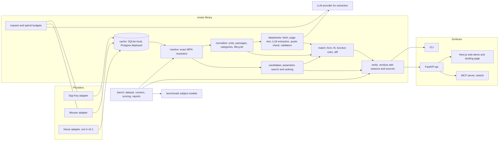

# Ersatz architecture

This document describes the system design for v0.1. Domain rules live in docs/DOMAIN.md, benchmark rules in docs/BENCHMARK_DESIGN.md, and every choice that changed from the first proposal has an entry in docs/DECISIONS.md.

## 1. System diagram



The library is the product. CLI, API, web and MCP are thin surfaces over it. Language model extraction runs offline from the CLI or a batch job and stores its results; no API request waits on a language model call.

## 2. Modules and public interfaces

Package layout:

```
ersatz/
  model/        pydantic models, no I/O
  normalize/    units, packages, categories, lifecycle mapping (pure functions)
  rules/        ldo.yaml, opamp.yaml, packages.yaml, lifecycle.yaml (data mirrored from DOMAIN.md)
  cache/        Cache protocol, SQLite and Postgres implementations
  budget/       request budgets per provider, spend ledger for LLM calls
  providers/    Provider protocol, digikey, mouser, http client, rate limiter
  resolve/      exact MPN resolution across providers
  datasheets/   fetch, page text, LLM extraction, quote verification, validation
  match/        form, fit and function scoring, diff
  candidates/   parametric candidate search and ranking
  verify/       verdicts
  bench/        dataset schema, curation, runners, token extraction, scoring, reports
  cli/          typer application
api/            FastAPI application (imports ersatz)
web/            Next.js application
mcp/            MCP server (stretch)
```

Units: every numeric value is stored as a float in SI base units: V, A, Hz, V/s, ohm, F, W, K for temperature differences, degC for absolute temperatures, dB for ratios, V/sqrt(Hz) for noise density. Formatting for display happens only in surfaces.

### ersatz.model

```python
class SourceKind(StrEnum): PROVIDER = "provider"; DATASHEET = "datasheet"

class Source(BaseModel, frozen=True):
    kind: SourceKind
    provider: str | None = None          # "digikey", "mouser"
    response_id: str | None = None       # sha256 of the raw response body
    retrieved_at: datetime
    url: str | None = None               # product page or datasheet URL
    sha256: str | None = None            # datasheet file hash
    revision: str | None = None          # datasheet literature number and revision
    page: int | None = None              # 1-indexed
    quote: str | None = None             # verbatim text that contains the value

class Sourced(BaseModel, Generic[T], frozen=True):
    value: T
    source: Source

class Lifecycle(StrEnum): ACTIVE; NRND; LAST_TIME_BUY; OBSOLETE; UNKNOWN
class Category(StrEnum): LDO = "ldo"; OPAMP = "opamp"

class Parameter(BaseModel, frozen=True):
    name: ParamName                      # enum of parameters per category
    min: float | None; typ: float | None; max: float | None
    unit: str                            # canonical SI unit
    conditions: dict[str, str]           # e.g. {"I_OUT": "0.2 A", "T_J": "25 degC"}
    source: Source

class Package(BaseModel, frozen=True):
    raw_name: str
    group: str | None                    # None means UNKNOWN
    pin_count: int | None
    body_width_mm: float | None
    height_max_mm: float | None
    source: Source

class Pin(BaseModel, frozen=True):
    number: str                          # "1", "TAB", "EP"
    function: PinFunction
    channel: int | None = None

class Pinout(BaseModel, frozen=True):
    pins: tuple[Pin, ...]
    source: Source

class Part(BaseModel, frozen=True):
    mpn: Sourced[str]                    # exactly as the provider returned it
    manufacturer: Sourced[str]
    category: Sourced[Category] | None
    lifecycle: tuple[Sourced[Lifecycle], ...]   # one per provider
    package: Package | None
    pinout: Pinout | None
    parameters: dict[ParamName, Parameter]
    datasheet_url: Sourced[str] | None
    stock: tuple[Sourced[int], ...]
```

Invariant: a Part can only be constructed from a provider record. There is no constructor that takes a bare string MPN.

### ersatz.providers

```python
class Capability(StrEnum): GET_PART; SEARCH_PARAMETRIC; SEARCH_KEYWORD

class ProviderRecord(BaseModel, frozen=True):
    provider: str
    mpn: str
    manufacturer: str
    raw_lifecycle: str | None
    raw_category: str | None
    raw_package: str | None
    raw_parameters: dict[str, str]
    datasheet_url: str | None
    stock: int | None
    product_url: str | None
    source: Source

class ParametricQuery(BaseModel, frozen=True):
    category: Category
    package_groups: tuple[str, ...]
    ranges: dict[ParamName, tuple[float | None, float | None]]
    in_stock_only: bool = False
    limit: int = 50

class Provider(Protocol):
    name: str
    capabilities: frozenset[Capability]
    def get_part(self, mpn: str, manufacturer: str | None = None) -> list[ProviderRecord]: ...
    def search_parametric(self, query: ParametricQuery) -> list[ProviderRecord]: ...
```

Each adapter owns its auth (Digi-Key OAuth2 client credentials with token refresh, Mouser API key), uses one shared HTTP client with retries on 429 and 5xx with exponential backoff and jitter, a token-bucket rate limiter per provider, and the daily request budget in ersatz.budget. search_parametric raises NotSupported when the capability is absent.

### ersatz.cache

```python
class DataKind(StrEnum): PROVIDER_RECORD; SEARCH_RESULT; DATASHEET_FILE; EXTRACTION; BUDGET

class Cache(Protocol):
    def get(self, kind: DataKind, key: str) -> CacheEntry | None: ...
    def put(self, kind: DataKind, key: str, payload: bytes, ttl: timedelta | None) -> None: ...
    def purge_expired(self) -> int: ...
```

Time-to-live per kind: provider records and search results 24 hours (the shortest provider limit, Nexar's, applied to all), datasheet files and extraction results without expiry because they are keyed by the PDF hash and the extractor version and contain no provider data. SqliteCache under cache/ for local use, PostgresCache for the deployed API.

### ersatz.normalize

```python
def parse_value(text: str, param: ParamName) -> ParsedValue          # min/typ/max in SI units
def package_group(raw: str, pin_count: int | None, body_width_mm: float | None) -> PackageMatch
def map_category(provider: str, raw: str) -> Category | None
def map_lifecycle(provider: str, raw: str | None, last_buy: date | None) -> Lifecycle
def normalize(record: ProviderRecord) -> Part
```

### ersatz.resolve

```python
class Resolution(BaseModel):
    query: str
    status: Literal["FOUND", "AMBIGUOUS", "NOT_FOUND"]
    parts: tuple[Part, ...]

def resolve(mpn: str, manufacturer: str | None, providers: Sequence[Provider]) -> Resolution
```

Exact match on the provider's MPN string, or the MPN plus a packaging suffix listed in rules/suffixes.yaml with a source. Never strips other characters.

### ersatz.datasheets

```python
def fetch(url: str, cache: Cache) -> DatasheetFile                    # path, sha256, url, fetched_at
def page_texts(file: DatasheetFile) -> list[PageText]                 # pdfplumber, per page
def select_pages(pages: list[PageText], category: Category) -> list[int]
def extract(file: DatasheetFile, pages: list[int], category: Category, llm: LLMClient) -> RawExtraction
def verify_quotes(raw: RawExtraction, pages: list[PageText]) -> Extraction   # drops unverified values
def validate(ex: Extraction, category: Category) -> list[ValidationIssue]

class LLMClient(Protocol):
    def extract_structured(self, pdf_pages: bytes, schema: type[BaseModel], prompt: str) -> LLMResult: ...
```

### ersatz.match

```python
class RuleResult(BaseModel):
    rule_id: str; status: Literal["PASS", "WARN", "FAIL", "UNKNOWN"]
    original: Parameter | None; candidate: Parameter | None
    reason: str; domain_refs: tuple[str, ...]

def score_form(o: Part, c: Part) -> FormResult
def score_fit(o: Part, c: Part) -> FitResult                           # DROP_IN, SAME_PACKAGE_REWIRE, NO, UNKNOWN
def score_function(o: Part, c: Part, rules: RuleSet) -> list[RuleResult]
def compare(o: Part, c: Part) -> Comparison                            # all of the above plus the diff
```

Rules are loaded from rules/ldo.yaml and rules/opamp.yaml. Each rule row has the ID used in DOMAIN.md, so a diff line links to its cited source.

### ersatz.candidates, ersatz.verify

```python
def find_candidates(original: Part, providers: Sequence[Provider], limit: int = 20) -> list[Comparison]

class Verdict(StrEnum): VERIFIED; PARTIAL; MISMATCH; NOT_FOUND

class VerifyResult(BaseModel):
    verdict: Verdict
    original: Part
    suggested: Part | None
    suggested_as_entered: str | None     # only set when NOT_FOUND
    comparison: Comparison | None
    reasons: tuple[str, ...]
    notice: str                          # engineer validation notice, always present

def verify(original_mpn: str, suggested_mpn: str, ctx: Context) -> VerifyResult
```

### ersatz.bench

```python
class Row(BaseModel): ...                # fields from BENCHMARK_DESIGN.md, Selection criteria
class SubjectRunner(Protocol):
    model_id: str
    def ask(self, prompt: str) -> RawResponse: ...   # stores request, response, sha256
def extract_tokens(text: str) -> list[str]
def score_run(rows: list[Row], responses: list[RawResponse], ctx: Context) -> RunScore
def report(score: RunScore) -> str      # results.md
```

### Surfaces

- CLI: `ersatz lookup MPN`, `ersatz candidates MPN`, `ersatz verify ORIGINAL SUGGESTED`, `ersatz extract MPN`, `ersatz bench run|score|report`.
- API: `GET /v1/parts/{mpn}`, `GET /v1/parts/{mpn}/candidates`, `POST /v1/verify`, `GET /v1/health`. Every response includes sources and the notice field.
- Web: `/` landing page, `/verify`, `/part/[mpn]`, `/bench`.
- MCP (stretch): one tool, `verify_part(original, suggested)`, calling the API.

### Changes from the first proposal

1. Added ersatz.resolve: verify, candidates and the benchmark all need the same exact-match resolution, and it is where suffix rules live.
2. Added ersatz.candidates: candidate search was not assigned to a module.
3. Added ersatz.budget: request budgets and the LLM spend cap are shared by providers, datasheets and bench.
4. Added ersatz/rules as data files: rule tables are data with IDs that match DOMAIN.md, so a rule change is a reviewed data change, not a code change.
5. Cache is a protocol with SQLite and Postgres implementations, not SQLite only: the deployed API runs on serverless functions with no persistent disk (D-004).
6. Provider protocol gained capabilities and get_part takes an optional manufacturer: Mouser cannot do parametric search, and the same MPN can exist at two manufacturers.
7. Source is a first-class type with Sourced[T], not a field on Parameter only: lifecycle, MPN, manufacturer and stock need sources too.
8. Extraction verifies quotes locally instead of using API citations (D-021).
