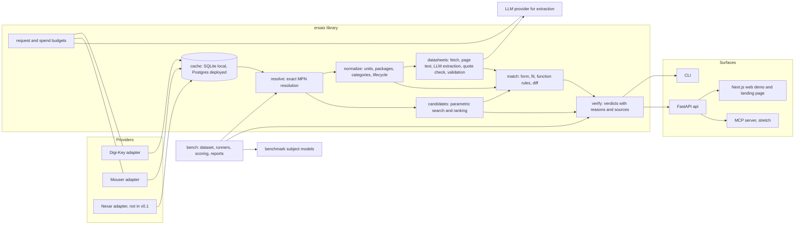

# Ersatz architecture

This document describes the system design for v0.1. Domain rules live in docs/DOMAIN.md, benchmark rules in docs/BENCHMARK_DESIGN.md, and every choice that changed from the first proposal has an entry in docs/DECISIONS.md.

## 1. System diagram

The library is the product. CLI, API, web and MCP are thin surfaces over it. Language model extraction runs offline from the CLI or a batch job and stores its results; no API request waits on a language model call.
